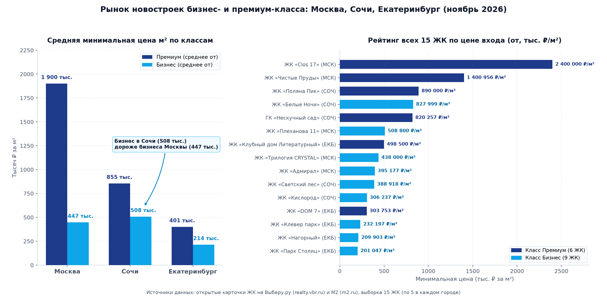
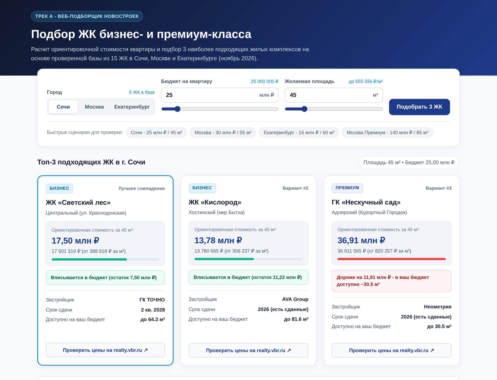
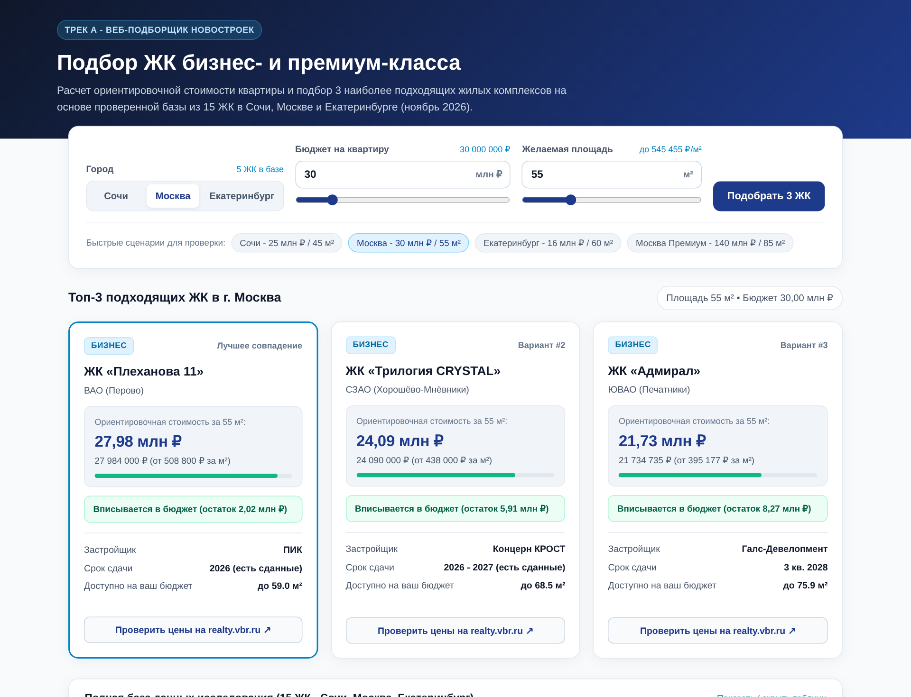
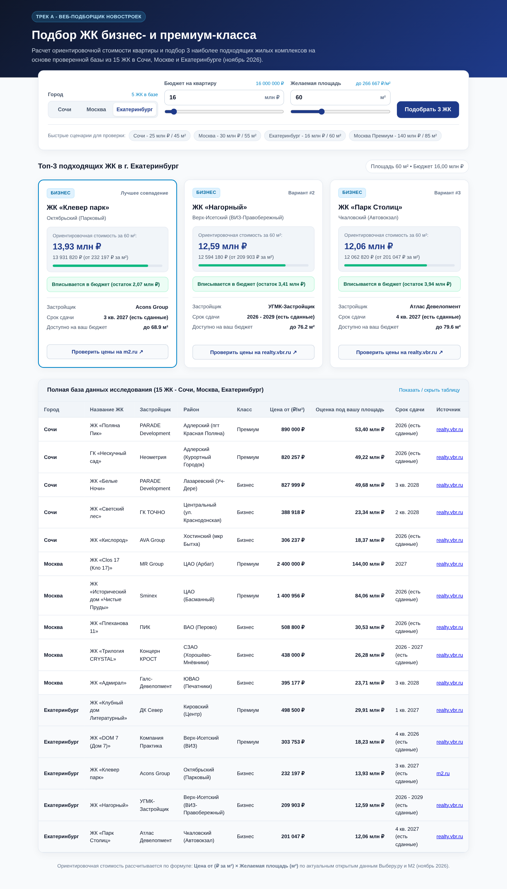

# Анализ рынка новостроек бизнес- и премиум-класса и веб-подборщик квартир

Репозиторий с решением тестового задания (Трек А «Код») для стажировки на позицию **Инженер по ИИ / AI-архитектор**.

- **Живое веб-приложение (GitHub Pages)**: [https://zerosniper.github.io/realty-matcher-ai/](https://zerosniper.github.io/realty-matcher-ai/)
- **Исходные данные**: [`zhk_dataset_15.csv`](./zhk_dataset_15.csv) и [`zhk_dataset_15.xlsx`](./zhk_dataset_15.xlsx)
- **Код подборщика**: [`index.html`](./index.html) (автономное одностраничное приложение на чистом HTML/CSS/JS без внешних зависимостей)

---

## Часть 1. Данные и аналитика (15 ЖК: Сочи, Москва, Екатеринбург)

Для честного межгородского сравнения в каждом городе отобрана одинаковая структура выборки: **2 проекта класса «Премиум»** и **3 проекта класса «Бизнес»**. Все цены верифицированы по открытым карточкам агрегаторов `realty.vbr.ru` и `m2.ru` (актуальность - ноябрь 2026).

| № | Город | Название ЖК | Застройщик | Район | Класс | Цена от (₽ за м²) | Срок сдачи | Источник |
|---|---|---|---|---|---|---:|---|---|
| 1 | Сочи | ЖК «Поляна Пик» | PARADE Development | Адлерский (пгт Красная Поляна) | Премиум | 890 000 | 2026 (есть сданные) | [realty.vbr.ru](https://realty.vbr.ru/sochi/novostroyki/zhk/polyana-pik/) |
| 2 | Сочи | ГК «Нескучный сад» | Неометрия | Адлерский (Курортный Городок) | Премиум | 820 257 | 2026 (есть сданные) | [realty.vbr.ru](https://realty.vbr.ru/sochi/novostroyki/zhk/gostinicnii-kompleks-neskycnii-sad/) |
| 3 | Сочи | ЖК «Белые Ночи» | PARADE Development | Лазаревский (Уч-Дере) | Бизнес | 827 999 | 3 кв. 2028 | [realty.vbr.ru](https://realty.vbr.ru/sochi/novostroyki/zhk/belie-noci-6/) |
| 4 | Сочи | ЖК «Светский лес» | ГК ТОЧНО | Центральный (ул. Краснодонская) | Бизнес | 388 918 | 2 кв. 2028 | [realty.vbr.ru](https://realty.vbr.ru/sochi/novostroyki/zhk/svetskii-les/) |
| 5 | Сочи | ЖК «Кислород» | AVA Group | Хостинский (мкр Бытха) | Бизнес | 306 237 | 2026 (есть сданные) | [realty.vbr.ru](https://realty.vbr.ru/sochi/novostroyki/zhk/kislorod-3/) |
| 6 | Москва | ЖК «Clos 17 (Кло 17)» | MR Group | ЦАО (Арбат) | Премиум | 2 400 000 | 2027 | [realty.vbr.ru](https://realty.vbr.ru/moskva/novostroyki/zhk/clos-17--klo-17-/) |
| 7 | Москва | ЖК «Исторический дом «Чистые Пруды» | Sminex | ЦАО (Басманный) | Премиум | 1 400 956 | 2026 (есть сданные) | [realty.vbr.ru](https://realty.vbr.ru/moskva/novostroyki/zhk/cistie-prydi-1/) |
| 8 | Москва | ЖК «Плеханова 11» | ПИК | ВАО (Перово) | Бизнес | 508 800 | 2026 (есть сданные) | [realty.vbr.ru](https://realty.vbr.ru/moskva/novostroyki/zhk/plehanova-11/) |
| 9 | Москва | ЖК «Трилогия CRYSTAL» | Концерн КРОСТ | СЗАО (Хорошёво-Мнёвники) | Бизнес | 438 000 | 2026 - 2027 (есть сданные) | [realty.vbr.ru](https://realty.vbr.ru/moskva/novostroyki/zhk/crystal-trilogiya--kristall-trilogiya-/) |
| 10 | Москва | ЖК «Адмирал» | Галс-Девелопмент | ЮВАО (Печатники) | Бизнес | 395 177 | 3 кв. 2028 | [realty.vbr.ru](https://realty.vbr.ru/moskva/novostroyki/zhk/admiral-21/) |
| 11 | Екатеринбург | ЖК «Клубный дом Литературный» | ДК Север | Кировский (Центр) | Премиум | 498 500 | 1 кв. 2027 | [realty.vbr.ru](https://realty.vbr.ru/ekaterinburg/novostroyki/zhk/po-yl-pervomaiskaya-1/) |
| 12 | Екатеринбург | ЖК «DOM 7 (Дом 7)» | Компания Практика | Верх-Исетский (ВИЗ) | Премиум | 303 753 | 4 кв. 2026 (есть сданные) | [realty.vbr.ru](https://realty.vbr.ru/ekaterinburg/novostroyki/zhk/dom-7--dom-7-/) |
| 13 | Екатеринбург | ЖК «Клевер парк» | Acons Group | Октябрьский (Парковый) | Бизнес | 232 197 | 3 кв. 2027 (есть сданные) | [m2.ru](https://m2.ru/yekaterinburg/novostroyki/zhk-klever-park-3216/) |
| 14 | Екатеринбург | ЖК «Нагорный» | УГМК-Застройщик | Верх-Исетский (ВИЗ-Правобережный) | Бизнес | 209 903 | 2026 - 2029 (есть сданные) | [realty.vbr.ru](https://realty.vbr.ru/ekaterinburg/novostroyki/zhk/nagornii-1/) |
| 15 | Екатеринбург | ЖК «Парк Столиц» | Атлас Девелопмент | Чкаловский (Автовокзал) | Бизнес | 201 047 | 4 кв. 2027 (есть сданные) | [realty.vbr.ru](https://realty.vbr.ru/ekaterinburg/novostroyki/zhk/park-stolic/) |

### График сравнения цен

### Ключевые аналитические выводы

1. **Потолок цен сосредоточен в историческом центре Москвы (разрыв до 11,9 раза)**: самые дорогие проекты выборки находятся в ЦАО Москвы - ЖК «Clos 17» на Арбате (`от 2 400 000 ₽/м²`) и «Чистые Пруды» (`от 1 400 956 ₽/м²`). Разница со стартом бизнес-класса в Екатеринбурге («Парк Столиц», `от 201 047 ₽/м²`) достигает почти 12 раз.
2. **Самый доступный вход в бизнес и премиум - в Екатеринбурге**: средняя минимальная цена по 5 ЖК составляет `289 080 ₽/м²` (`214 382 ₽/м²` в бизнесе и `401 126 ₽/м²` в премиуме). Даже камерный клубный дом «Литературный» в центре Екатеринбурга (`от 498 500 ₽/м²`) обходится дешевле базового московского бизнес-класса от ПИК в Перово (`от 508 800 ₽/м²`).
3. **Неожиданный инсайт - бизнес-класс в Сочи дороже московского**: если в премиум-сегменте Москва более чем вдвое опережает Сочи (`1,90 млн` против `855 тыс. ₽/м²`), то в бизнес-классе ситуация переворачивается - средний порог входа в Сочи выше (`507 718 ₽/м²` против `447 326 ₽/м²` в Москве). Сказывается дефицит земли под застройку и курортная наценка.
4. **В Сочи береговая линия и горы стирают границу между классами**: бизнес-класс у моря в Уч-Дере (ЖК «Белые Ночи», `от 827 999 ₽/м²`) стоит на уровне премиум-комплекса в Курортном Городке (ГК «Нескучный сад», `от 820 257 ₽/м²`) и в 2,7 раза дороже городского бизнес-класса на Бытхе (ЖК «Кислород», `от 306 237 ₽/м²`).
5. **Максимальное внутригородское расслоение наблюдается в Москве**: переход от бизнес-класса в ЮВАО (`395 тыс. ₽/м²`) к клубному дому в ЦАО (`2,4 млн ₽/м²`) увеличивает стоимость метра в **6,1 раза**, тогда как внутри Сочи и Екатеринбурга разрыв между минимумом и максимумом выборки составляет **2,9** и **2,5 раза**.

---

## Часть 2. Трек А «Код» - Интерактивный веб-подборщик квартир

Веб-приложение реализовано в файле [`index.html`](./index.html). Оно не требует серверного бэкенда или платного хостинга и открывается как локально в любом браузере, так и через GitHub Pages.

### Как работает алгоритм подбора:
1. Пользователь задает **город** (`Сочи`, `Москва`, `Екатеринбург`), **бюджет на квартиру (млн ₽)** и **желаемую площадь (м²)** с помощью полей ввода, ползунков или готовых пресетов.
2. Для каждого ЖК выбранного города рассчитывается ориентировочная стоимость квартиры (`Цена от за м² × Площадь`), остаток или нехватка бюджета, а также максимальная площадь, доступная строго в рамках указанного бюджета.
3. Алгоритм выводит **топ-3 подходящих ЖК**:
   - В приоритете идут комплексы, укладывающиеся в бюджет (отсортированные по наиболее полному и качественному использованию бюджета).
   - Если в бюджете меньше 3 объектов, выдача дополняется ближайшими по цене вариантами в этом городе с прозрачным расчетом суммы доплаты и доступного метража.

### Скриншоты работы веб-приложения

#### 1. Подбор в г. Сочи (бюджет 25 млн ₽, площадь 45 м²)

#### 2. Подбор в г. Москва (бюджет 30 млн ₽, площадь 55 м²)

#### 3. Подбор в г. Екатеринбург (бюджет 16 млн ₽, площадь 60 м²) + развернутая таблица базы

